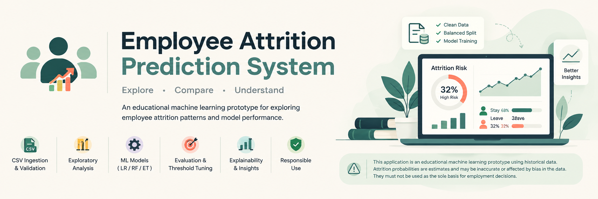

<div align="center">



# Employee Attrition Prediction System

*Streamlit app + scikit-learn model that estimates employee attrition probability.*


**No login · No database · Uploads processed in memory and never saved**

</div>

> ⚠️ Educational prototype on fictional data (IBM HR Analytics). Predictions are estimates, may be biased
> or wrong, and must not be the sole basis for employment decisions.

## 🚀 Quick start

```bash
python -m venv .venv
source .venv/bin/activate          # Windows: .venv\Scripts\Activate.ps1
pip install -r requirements.txt
python train.py                    # trains + saves models/attrition_model.joblib (~1 min)
streamlit run app.py               # opens the app, no login
pytest -q                          # tests
```

A trained model is already included in `models/`, so you can skip `train.py` if package versions match.

## ☁️ Deploy to Streamlit Community Cloud (free public link)

GitHub Pages cannot run Python, so publish the app on [Streamlit Community Cloud](https://streamlit.io/cloud) instead:

1. Push this repository to GitHub (the app needs `app.py`, `core.py`, `report.py`, `requirements.txt`, `data/`, and `models/attrition_model.joblib`).
2. Sign in at [share.streamlit.io](https://share.streamlit.io) with your GitHub account and choose **New app**.
3. Set Repository / Branch / **Main script path = `app.py`**, then deploy.
4. You get a public link like `employee-attrition-prediction-system.streamlit.app` — no login required for visitors, model and data load from the repo, no external APIs.

Note: the app is publicly reachable, so only ever bundle fictional or authorised data (it currently ships with the fictional IBM-style sample).

## 🧭 What it does

| Tab | Features |
|---|---|
| **📊 Data Explorer** | Built-in sample or your own CSV: data-quality checks, attrition rate by department/role/overtime/satisfaction/tenure/income (only if an `Attrition` Yes/No column exists), PDF report |
| **🔮 Predict** | Single-employee form, or batch CSV (template provided). Threshold slider changes labels, never probabilities. Download CSV of all rows + PDF report |
| **📈 Model Performance** | CV model comparison, real hold-out metrics, confusion matrix, permutation importance, PDF report |

## 🧪 Data and training protocol (`train.py`)

- `data/real_train_80pct.csv` (1,176 real rows), `data/real_holdout_20pct_DO_NOT_TRAIN.csv` (294 real rows),
  `data/synthetic_hr_attrition_12000.csv` (synthetic, generated from the training rows only).
- Candidates (LogReg, RandomForest, GradientBoosting) compared by 5-fold CV on **real training rows only**.
- Threshold = F1-optimal point on out-of-fold predictions.
- Final model refit on real + synthetic (real weighted x5). Hold-out is used only for reporting.
- **Excluded from model inputs:** Age, Gender, MaritalStatus (sensitive), EmployeeNumber, EmployeeCount, Over18, StandardHours.

## 📋 Batch CSV rules

Required: all columns in the template. Missing columns, non-numeric values in numeric columns, or empty cells
in required columns are rejected (nothing is filled in silently). Extra columns are ignored but kept in the output.
An existing `Attrition` column is kept untouched; outputs are `predicted_attrition_probability` and `predicted_attrition`.

## 🗂️ Project structure

```
app.py      Streamlit UI
core.py     validation + prediction
train.py    training pipeline
report.py   PDF builder
tests/      test_basic.py
data/       real train/holdout + synthetic CSVs
models/     attrition_model.joblib + metrics.json
```

## 🔭 Future enhancements (not implemented)

Planned ideas, not features of the current app:

- ZIP "complete report package" bundling all PDFs + batch CSV into one download
- ROC and precision-recall curve charts in the PDF reports
- Standalone Model Explainability page (currently permutation importance sits inside Model Performance)
- TabPFN (tabular foundation model) benchmark alongside the conventional candidates

## ⚠️ Limitations

Small data (1,470 original employees); hold-out has only ~47 leavers so metrics are noisy. Synthetic data adds
no new real information. Probabilities are not guaranteed to be calibrated. Feature importance is not causation.
If deployed publicly, anyone can reach the app — use only fictional or authorised data.

---

<div align="center">

Released under the [MIT License](LICENSE).

</div>
